<p align="center">
  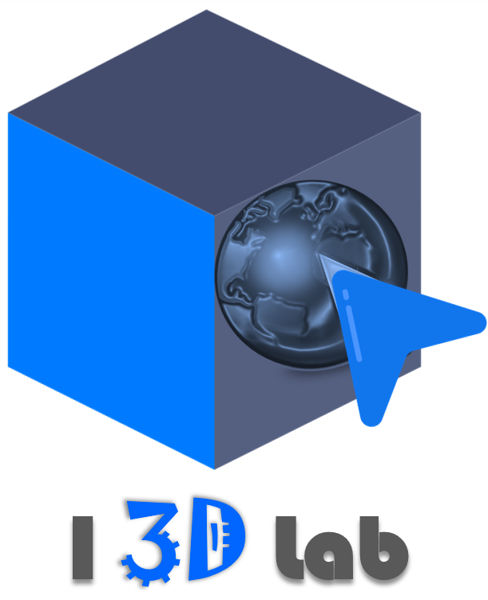
</p>

# I 3D LAB (frontend)

[](https://reactjs.org/)
[](https://www.javascript.com/)

## Table of Contents
- [I 3D LAB (frontend)](#i-3d-lab-frontend)
  - [Table of Contents](#table-of-contents)
  - [Introduction](#introduction)
  - [Features & Screenshots](#features--screenshots)
    - [Dashboard & Model Library](#dashboard--model-library)
    - [3D Workspace, Tools & Collaboration](#3d-workspace-tools--collaboration)
    - [2D-to-3D Reconstruction & Point Cloud Segmentation](#2d-to-3d-reconstruction--point-cloud-segmentation)
    - [Cross-Section & Annotations](#cross-section--annotations)
    - [Sample 3D Models](#sample-3d-models)
  - [Tech Stack](#tech-stack)
  - [Installation](#installation)
    - [Prerequisites](#prerequisites)
    - [Steps](#steps)

## Introduction

A web-based collaborative 3D model configuration and interactive lab platform.

## Features & Screenshots

### Dashboard & Model Library

| Dashboard (`My Rooms` / `My Models`) | Model Categories |
| :---: | :---: |
| 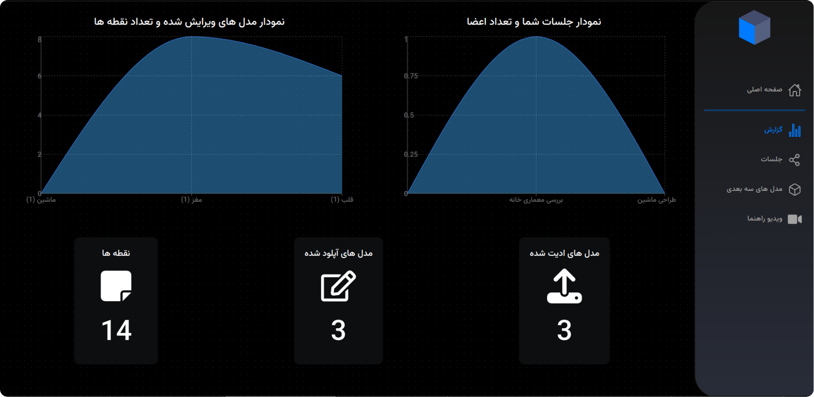 | 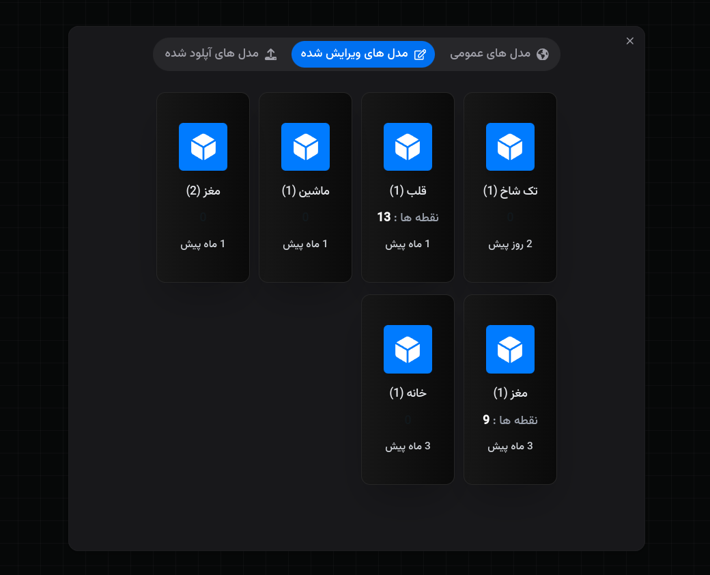 |

### 3D Workspace, Tools & Collaboration

| Session Toolbar | Editor Toolbar | Transform Panel |
| :---: | :---: | :---: |
| 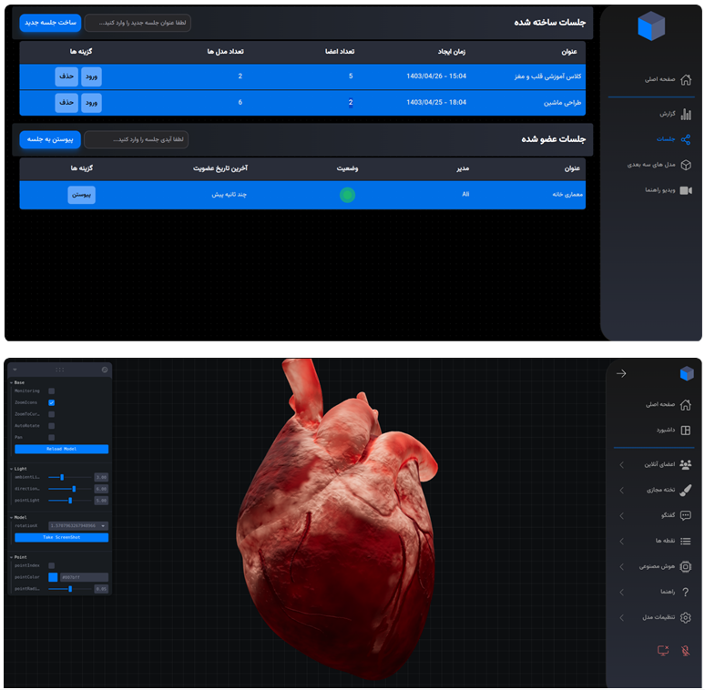 | 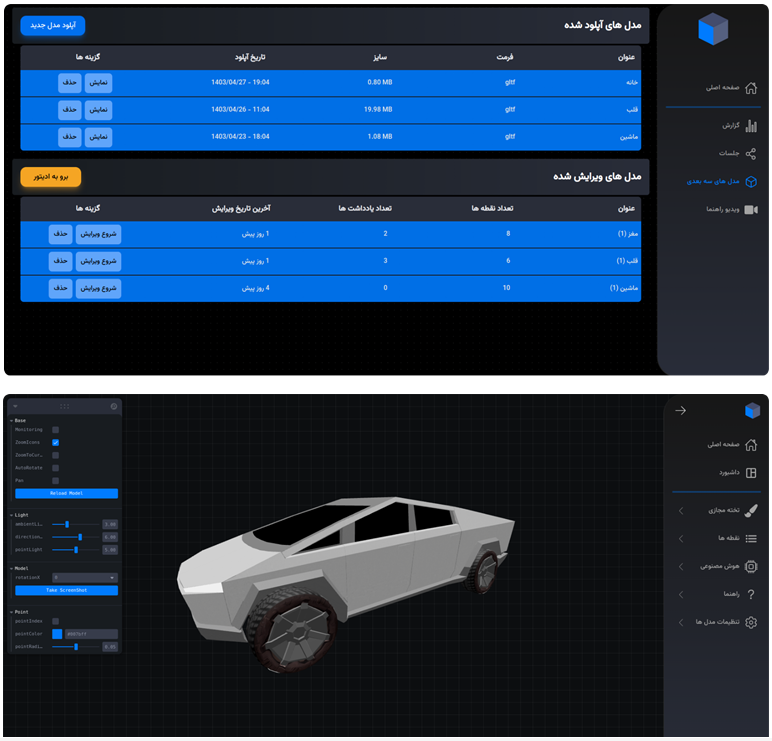 | 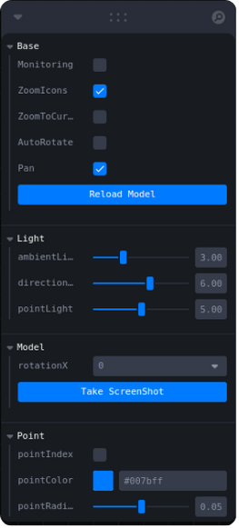 |

| Add Multiple Models | Floating Screen Share | Virtual Whiteboard |
| :---: | :---: | :---: |
| 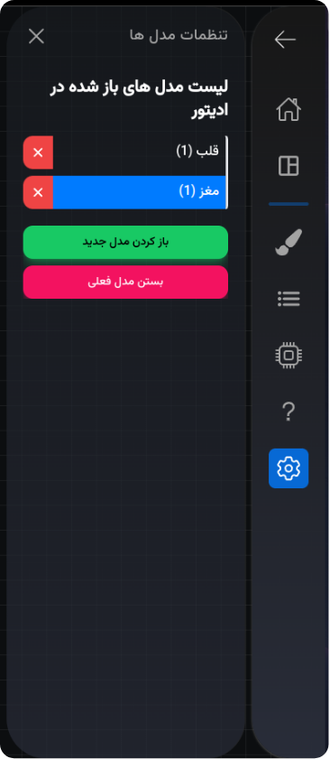 | 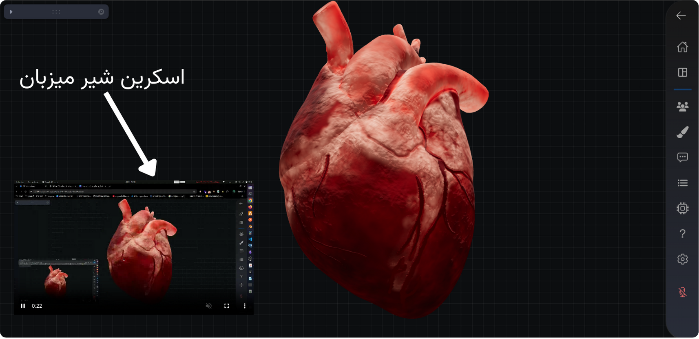 | 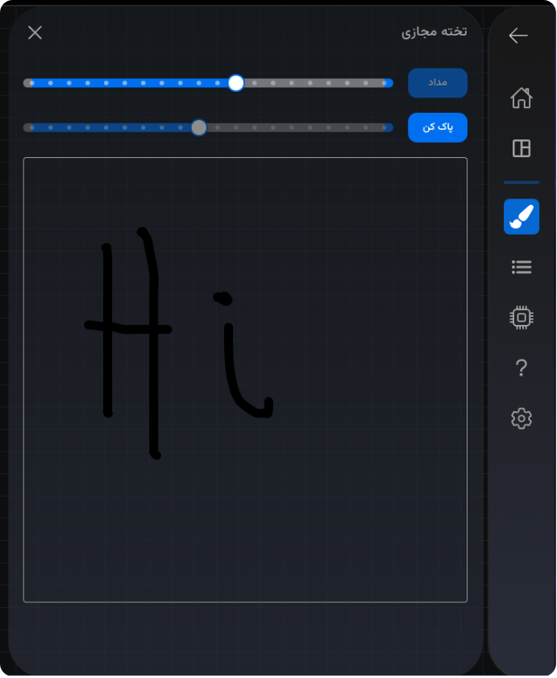 |

### 2D-to-3D Reconstruction & Point Cloud Segmentation

| 2D Input Reference | Reconstructed 3D Model | 3D Heart Point Cloud Segmentation |
| :---: | :---: | :---: |
| 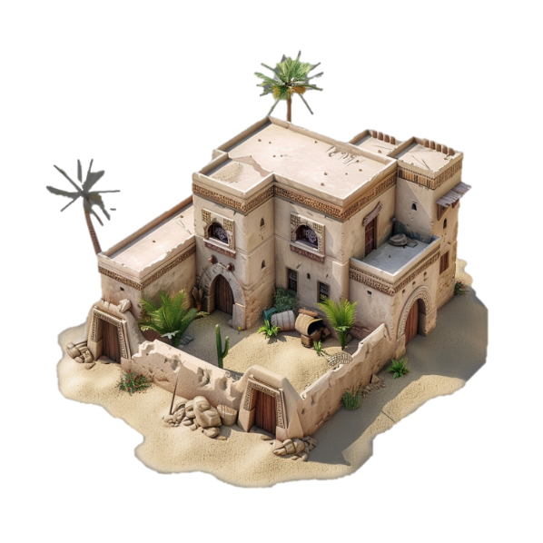 | 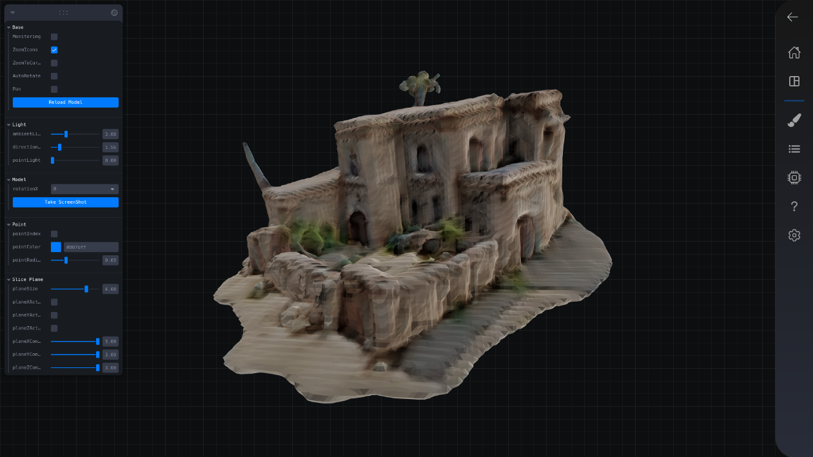 | 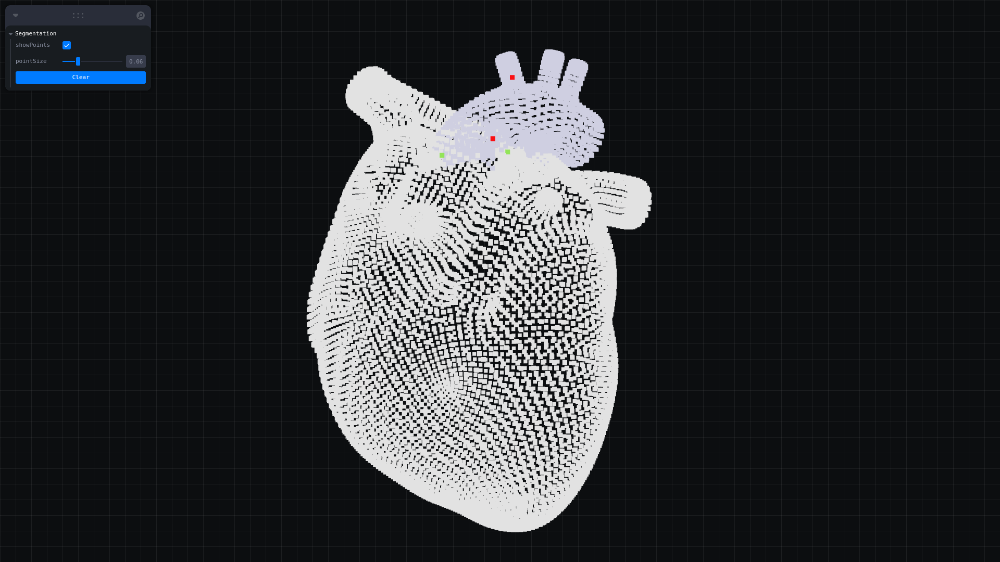 |

### Cross-Section & Annotations

| Cross-Section View (1) | Cross-Section View (2) |
| :---: | :---: |
| 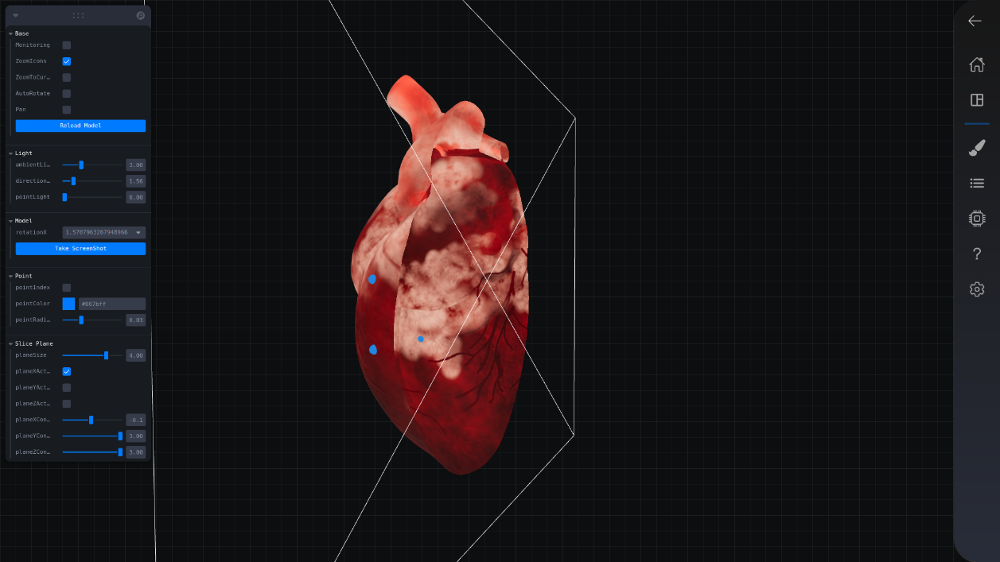 | 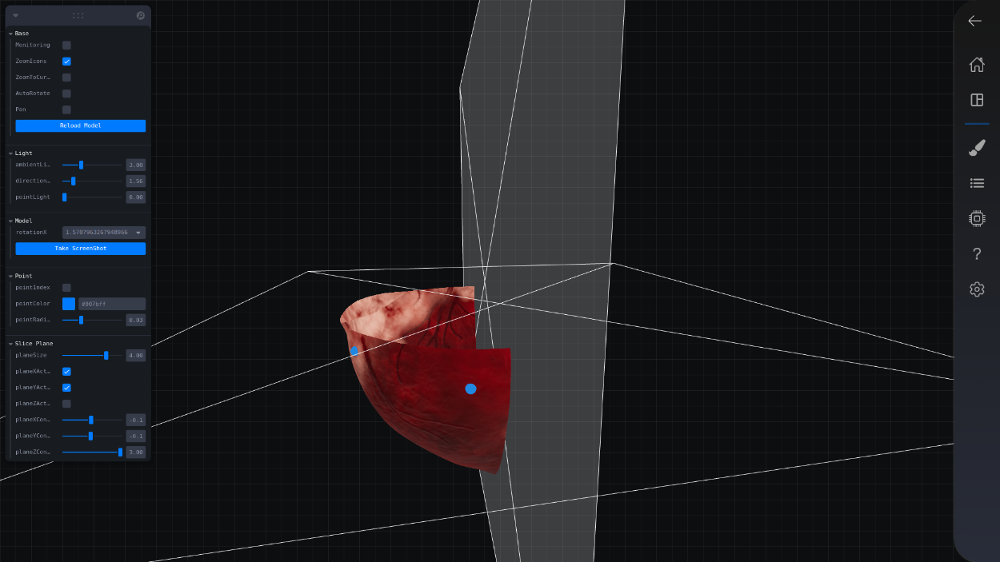 |

| 3D Pins & Annotations | Marker Note Modal |
| :---: | :---: |
| 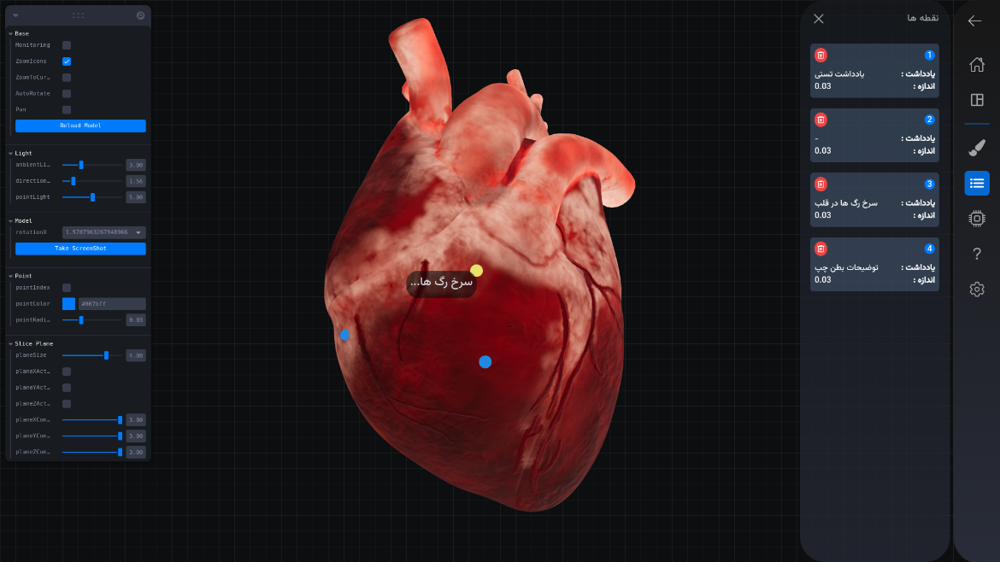 | 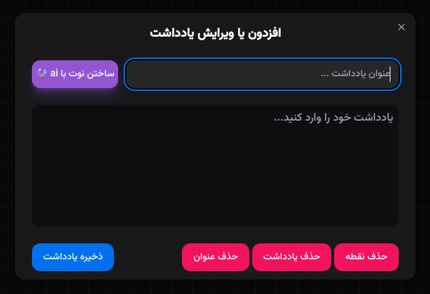 |

### Sample 3D Models

| 3D Heart Model | Architectural Structure | Tesla Cybertruck |
| :---: | :---: | :---: |
| 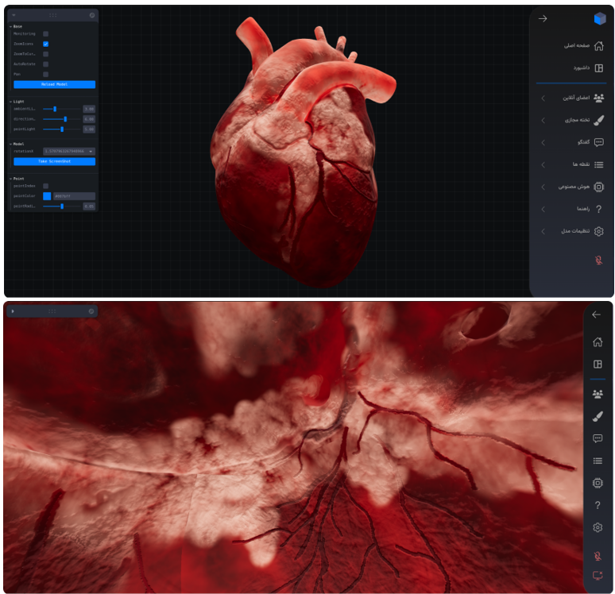 | 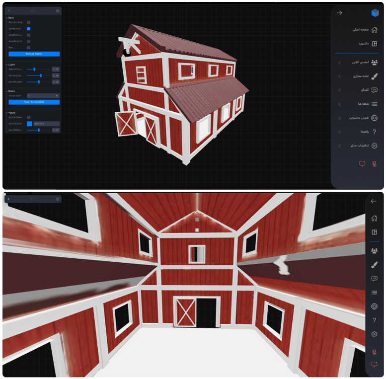 | 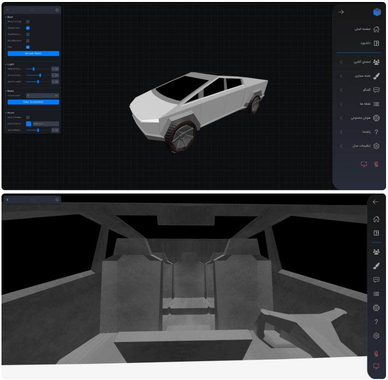 |

## Tech Stack

- **Framework:** React 17.0.2+
- **Programming Language:** JavaScript (ES6+)
- **Build Tool:** Vite
- **State Management:** Zustand/React Query
- **Routing:** React Router
- **Styling:** Tailwind CSS

## Installation

### Prerequisites

Ensure you have the following installed:

- Node.js (version 14.0.0+ recommended)
- npm or yarn

### Steps
1. **Install dependencies**
    ```sh
    npm install
    # or
    yarn install
    ```

2. **Start the development server**
    ```sh
    npm run
    # or
    yarn run
    ```


This README was generated with ❤️ by Mohammad Hosein Yaghoubi.